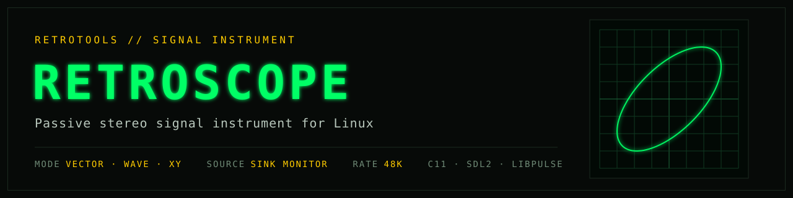
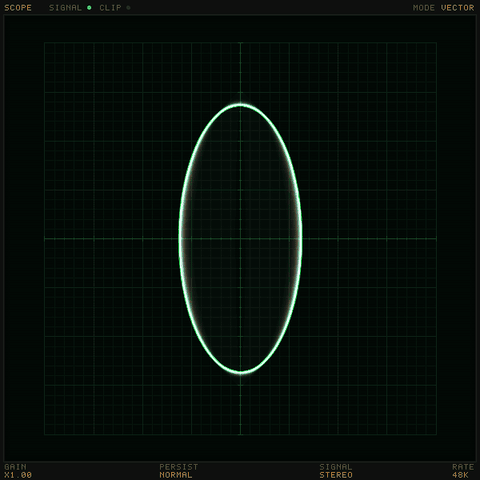
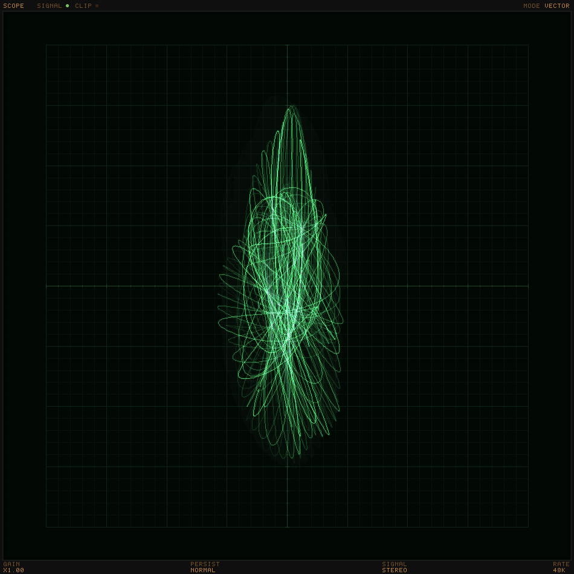
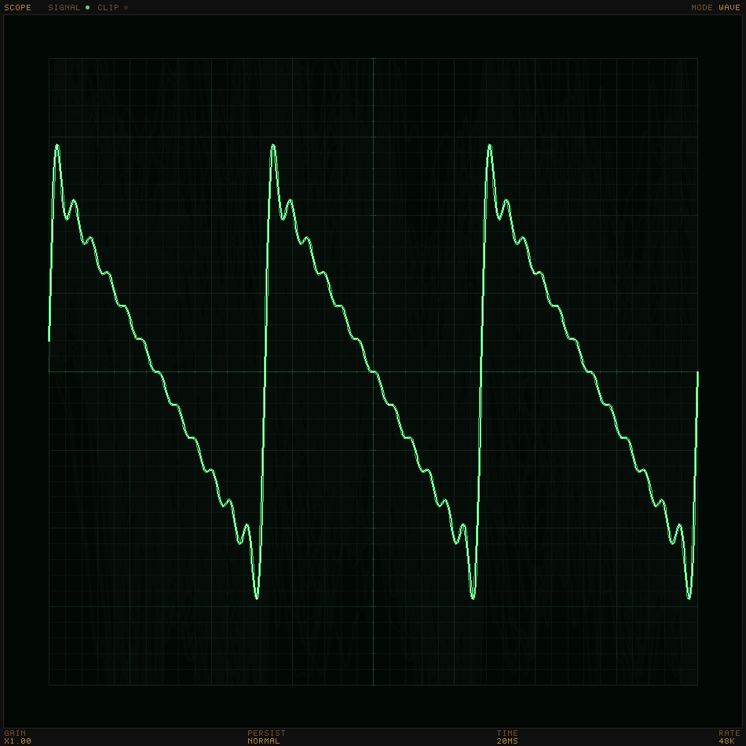
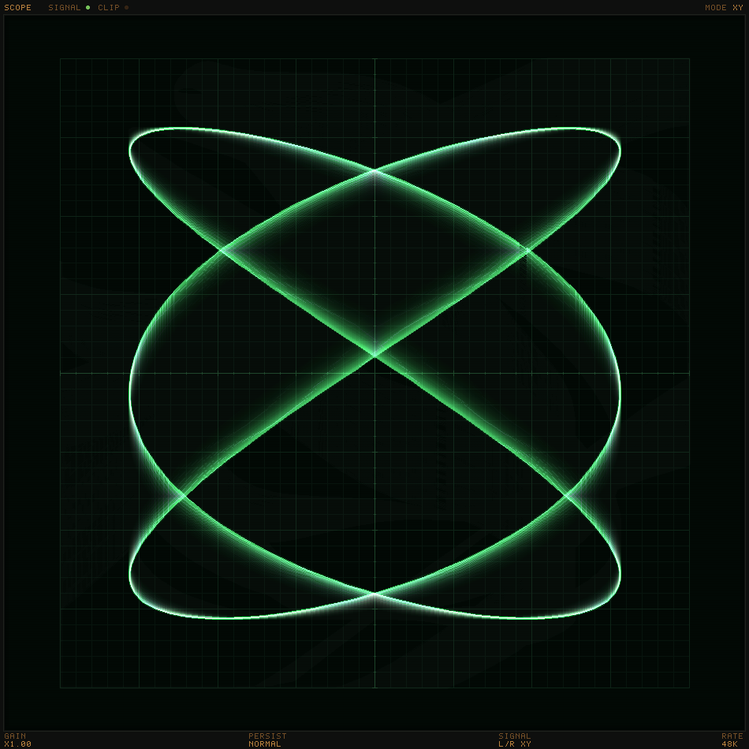

<p align="center">
  
</p>

**RetroScope** turns whatever your Linux desktop is playing into a phosphor trace. It listens
*passively* to the monitor of your default audio output and draws it as a stereo vectorscope,
a triggered waveform or an X/Y oscilloscope, in a dark CRT-style instrument panel.

One small C11 binary on SDL2 and libpulse. No configuration, no font files, no network.

<p align="center">
  
  <br><sub>The real app window running <code>./retroscope --demo</code>, switching modes with keys 1, 2 and 3.</sub>
</p>

## Three views of one signal

| VECTOR — key `1` | WAVE — key `2` | XY — key `3` |
| :---: | :---: | :---: |
| <a href="docs/media/vector.png"></a> | <a href="docs/media/wave.png"></a> | <a href="docs/media/xy.png"></a> |
| Stereo image (mid/side).<br>A mono signal is a vertical line. | Triggered waveform of the mono mix.<br>Timebase 20, 5 or 40 ms (`B`). | Classic X = left, Y = right.<br>Made for oscilloscope music. |

These are real window captures of RetroScope 0.1.0 capturing live audio on a Wayland desktop.
The audio is self-generated: an A-minor chord with drifting stereo phase, a 150 Hz
band-limited sawtooth and a slowly turning 3:2 Lissajous figure. It was played into a silent
virtual output, so no recording or third-party music is involved. See
[`tools/showcase/`](tools/showcase/) to reproduce them.

## Features

- **Three display modes**, switchable live: VECTOR, WAVE and XY.
- **Passive capture.** It records only the monitor of the default output (what you hear). It never opens a microphone and never plays, stores or sends audio.
- **Phosphor persistence** with exponential, frame-rate independent fade. There are four levels: FAST, NORMAL, LONG and GHOST.
- **Display gain** from ×0.25 to ×16. It scales the drawing only; your audio is never modified.
- **Working status lamps.** SIGNAL lights on fresh input. CLIP lights when the current gain clips the drawn trace.
- **Built-in demo signal** (`--demo`) that needs no audio server.
- **Adaptive, HiDPI-aware panel** with a built-in bitmap font. It keeps working in small tiling-window-manager tiles.

## Requirements

- Linux with a PulseAudio-compatible audio server for live mode. Normally this is PipeWire with `pipewire-pulse`.
- A C11 compiler, `make` and `pkg-config` (or `pkgconf`).
- SDL2 2.0.18 or newer, and libpulse.

**Tested for v0.1.0:** Omarchy (Arch-based) on x86_64 with Hyprland on Wayland. The toolchain was GCC 16 and Clang 23, sdl2-compat 2.32 (the SDL2 API on SDL3), libpulse 17 and PipeWire 1.6. Other distributions, X11 and classic SDL2 builds have **not** been tested yet. See [docs/QA.md](docs/QA.md).

Install the dependencies:

```sh
# Arch / Omarchy (tested)
sudo pacman -S --needed base-devel pkgconf sdl2-compat libpulse
# Debian / Ubuntu (untested)
sudo apt install build-essential pkg-config libsdl2-dev libpulse-dev
# Fedora (untested)
sudo dnf install gcc make pkgconf-pkg-config SDL2-devel pulseaudio-libs-devel
```

If a dependency is missing, `make` stops at once and names it.

## Quickstart: demo mode

```sh
make
./retroscope --demo
```

`--demo` generates a stereo test signal internally and never connects to an audio server.
Press `1`, `2` and `3` to switch modes and `Q` to quit.

## Quickstart: your desktop audio

Start it from a terminal in your normal desktop session while something is playing:

```sh
./retroscope
```

At startup RetroScope asks the audio server for the current default output and records that
output's **monitor**, the copy of what is being played. It prints the source it uses:

```text
RetroScope: Monitor <your-default-output>.monitor, 48 kHz Stereo
```

If no audio server is reachable, RetroScope exits with a readable message instead of hanging.

## Controls

| Key | Action |
| --- | --- |
| `1` `2` `3` (also on the keypad) | VECTOR, WAVE or XY |
| `B` | WAVE timebase: 20, 5 or 40 ms |
| `+` `=` `↑` and `-` `↓` | Display gain up or down (×0.25 to ×16, in quarter octaves) |
| `0` | Reset gain to ×1.00 |
| `←` and `→` | Shorter or longer persistence (70, 140, 300 or 600 ms) |
| `H` | Print help to the terminal |
| `Q`, `Esc` or closing the window | Quit |

Command line: `retroscope [--demo] [--seconds N] [--version] [--help]`. `--seconds N` ends the run after N seconds (1 to 86400), which is useful for scripted tests.

## Install, uninstall

```sh
make install PREFIX=$HOME/.local     # or: sudo make install (PREFIX=/usr/local)
make uninstall PREFIX=$HOME/.local   # removes exactly that one file
```

`make install` copies a single binary to `$(PREFIX)/bin` and supports `DESTDIR`. RetroScope
needs no root rights to build or run, and it writes no files.

## How it works

```text
PipeWire-Pulse ─► <default output>.monitor ─► audio thread (libpulse)
                                                 │ ring buffer, 2048 frames (≈43 ms)
                                                 ▼
SDL main loop (≈59 fps) ─► VECTOR · WAVE · XY projection ─► phosphor trail texture ─► window
```

The code is three files: `src/retroscope.c` covers capture, the command line and the main loop. `src/scope.h` holds the mode logic and the trigger. `src/instrument.h` draws the panel and holds the bitmap font. Together they are about 590 lines. Details are in [docs/ARCHITECTURE.md](docs/ARCHITECTURE.md).

## Tests and QA

```sh
make check         # CLI checks, headless demo run, unit and render test suites
make sanitize      # the same under AddressSanitizer, UBSan and LeakSanitizer
make audio-smoke   # real capture against a private, silent PipeWire instance
```

`make audio-smoke` starts its own PipeWire, WirePlumber and pipewire-pulse in a temporary
directory, with hardware access disabled. It checks the captured levels and channel order. It checks that a microphone is never used, that RetroScope stays on its output when the default changes, and how it handles a lost output or audio server. Nothing is audible and your desktop session is not touched. Results for this release are in [docs/QA.md](docs/QA.md).

## Audio privacy and security

| Question | Answer |
| --- | --- |
| What is captured? | Only the monitor of the default output at startup, as 48 kHz float stereo. |
| Can it use a microphone? | No. The source name comes only from the output's monitor, and the stream is pinned so the server cannot move it. This is tested with a fake microphone set as the default input. |
| Is audio stored? | No. Samples live only in fixed in-memory buffers of about 43 ms and 80 ms. RetroScope opens no files. |
| Does audio leave the machine? | No. RetroScope has no networking code; it talks only to your local audio server. |
| Which permissions does it need? | Only a normal desktop user with access to their own audio session. No root, capabilities or device files. |

More detail and vulnerability reporting: [SECURITY.md](SECURITY.md).

## Known limitations

- The output is chosen once, at startup. If you switch outputs, restart RetroScope. If the captured output or the audio server goes away, RetroScope exits with a message; it does not reconnect.
- Only sound routed to the default output is visible. Monitor levels may not follow hardware volume.
- It is a visual instrument, not a calibrated measuring device. The trigger has no hysteresis or holdoff. Under heavy load, old frames are dropped.
- Places where the trace has been can keep a very faint residual glow, about 1 % brightness, until you switch modes. This comes from 8-bit fading on the GPU.
- Terminal messages and the `H` help text are in German.
- Settings are not saved between runs.

## License

RetroScope is released under the [MIT License](LICENSE). It links dynamically to SDL2 (zlib
license) and libpulse (LGPL-2.1-or-later) and bundles no third-party code, fonts or media; see
[THIRD_PARTY_NOTICES.md](THIRD_PARTY_NOTICES.md).

Part of **RetroTools**, a family of small retro-styled Linux tools.
[Changelog](CHANGELOG.md) · [Release notes](docs/RELEASE_NOTES_v0.1.0.md)
